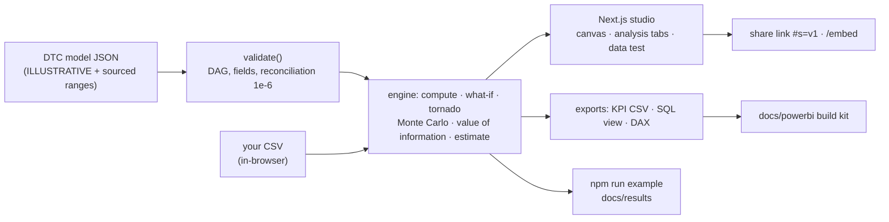

# Metric Driver-Tree Studio


[](https://github.com/RafaelBraga-Kribitz/metric_lineage_simulator/actions/workflows/governance.yml)
[](LICENSE)
[](#status)

**Status:** In development

KPI trees (Kennzahlensysteme) usually mix three different kinds of claim: definitions that are true by construction, assumed elasticities, and beliefs nobody has tested. When they sit in one formula, a guess looks as solid as a definition. This studio keeps the three apart, forecasts what the guesses imply, and ranks which guess is worth testing first.

## Decision summary

**Test the page-speed guess first.** On the illustrative DTC e-commerce model, uncertainty about how page load speed moves product-page views blurs a planned "10% faster pages" decision by **€5,832 of contribution profit per period** (P90 − P10, on a €48,000 baseline). That is 5.5× more value of information per unit of test cost than the next guess (email capture, €534). This ranks what to *learn*, not what to *do*.


*The ranking panel in the app: bar length is the spread of the north star that each guess's declared range produces; priority divides it by a declared test cost.*

The €5,832 figure comes from an elasticity range graded **estimated**: its bound is translated from the public Deloitte for Google study [*Milliseconds Make Millions* (2020)](https://web.dev/case-studies/milliseconds-make-millions), which associates 0.1 s faster mobile pages with +8.4% retail conversion. The edge's note in the app explains the translation. It is an external, observational benchmark, not a measurement of this shop.

```bash
git clone https://github.com/RafaelBraga-Kribitz/metric_lineage_simulator.git
cd metric_lineage_simulator/driver_tree_studio
npm ci
npm run dev            # studio at http://localhost:3000
npm test               # 92 unit tests: engine, statistics, exports
npm run example        # regenerates the result above into docs/results/
```

What it covers, in analyst terms: KPI and Kennzahlen design as a driver tree (Deckungsbeitrag down to funnel-stage Konversionsraten), forecasting under uncertainty (seeded Monte Carlo ranges), a bring-your-own-CSV relationship test, ETL-style validation (every identity must reconcile to 1e-6), and a hand-off to the BI stack: SQL view DDL, a KPI dictionary CSV and Power BI DAX measures. The engine is plain TypeScript with no statistics library, so every formula is readable in the source; there is no Python in the product.

## See it running


No hosted demo. Deployment is an owner step; the static build and Vercel config are ready ([docs/deploy.md](docs/deploy.md)). Every screen above is captured from the built app by `npm run screenshots`.

## Explore this project

| Audience | Start here |
|---|---|
| Hiring manager, 2 minutes | [Decision summary](#decision-summary) → [Results](#results) → [Limitations](#limitations) |
| Analyst / BI developer | [Power BI build kit](docs/powerbi/README.md) → [`kpi_tree.sql`](docs/powerbi/kpi_tree.sql) → [`measures.dax`](docs/powerbi/measures.dax) |
| Technical reviewer | [Method](#method) → [`estimate.ts`](driver_tree_studio/src/engine/estimate.ts) → [Validation](#validation) → [ADR-0010](governance/adrs/0010-portfolio-completion-scope.md) |

## Question

Given a contribution-profit tree for a direct-to-consumer shop, **which uncertain assumption should be tested before acting on it?** A second question runs through the whole tool: how do you show an assumption's uncertainty without dressing it up as evidence?

## Data

| Input | What it is | Epistemic status |
|---|---|---|
| [`dtc_ecommerce.json`](driver_tree_studio/src/content/dtc_ecommerce.json) | 18 metrics, 14 identity edges, 3 modeled edges, 1 hypothesized edge; contribution profit €48,000 per period | Baselines **ILLUSTRATIVE** |
| Page speed → product views range | triangular(−2.1, −0.5, 0) elasticity; two public sources stored on the edge | **Estimated** from public benchmarks |
| Email capture → returning sessions range | triangular(0, 0.3, 0.6) | **ILLUSTRATIVE**; no public source found, flagged in the UI |
| Loyalty → LTV | direction only, with a selection-trap warning | **Hypothesized**; never computed |
| Your CSV (data-test tab) | any two numeric columns; read in the browser, never uploaded | yours |
| [`kpi_inputs_SYNTHETIC.csv`](docs/powerbi/kpi_inputs_SYNTHETIC.csv) | 12 months generated from the baselines with seeded 5% noise | **SYNTHETIC**, for the BI kit only |

German labels (Deckungsbeitrag, Warenkorbwert, Konversionsrate) are illustrative textbook terms, not any company's definitions. No personal, scraped or client data is in this repository.

## Method

Three edge kinds, drawn differently everywhere in the UI:

| Kind | Canvas | What is claimed | Used in numbers |
|---|---|---|---|
| `identity` | thick blue | true by definition (`orders = sessions × conversion_rate`) | yes, exactly |
| `modeled` | amber + grade chip | an elasticity with a named functional form and a declared range | yes, flagged |
| `hypothesized` | grey dashed + “?” | a direction only | no |

1. **Compute.** Values flow child → parent in topological order. Modeled effects multiply onto their target.
2. **What-if and tornado.** Move any controllable input; the tornado shows the north-star change at ±10% per lever.
3. **Forecast range.** Monte Carlo (seeded, in a Web Worker) samples input ranges and elasticity ranges and reports P10 / P50 / P90 plus each input's share of the spread.
4. **Value of information.** For each modeled edge with a range: move its driver by the planned change, sample only that edge's elasticity (20,000 draws), and take P90 − P10 of the north star. Priority = that spread ÷ declared test cost.
5. **Test with data.** Pearson r with a Fisher-z 95% CI, OLS with a t-based slope CI, elasticity at the means, and an 80/20 out-of-sample r². The verdict separates *association* from *effect*. Every verdict carries a fixed note and a “what would prove this” design. Accepting promotes the edge's grade to `observational`, or to `experimental` only if the user declares a randomized design.

## Results

### Page speed ranks first: €5,832 value of information, 5.5× the next guess

| Rank | Guess | Grade | Planned change | Contribution profit P10 – P90 | VoI | Test cost | Priority |
|---|---|---|---|---|---|---|---|
| 1 | page load speed → product view rate | estimated | −10% load time | €49,534 – €55,366 | €5,832 | 2 | 2,916 |
| 2 | email capture → returning sessions | illustrative | +10% capture | €48,214 – €48,747 | €534 | 1 | 534 |
| — | average order value → customer LTV | illustrative | — | does not feed the north star | — | 3 | — |
| — | loyalty → customer LTV | none | — | needs a range first | — | 5 | — |

Compared with the €48,000 baseline, the page-speed range spans a profit gain of 3% to 15%, while email capture's spans 0.4% to 1.6%. Even after dividing by a test cost twice as high, page speed stays ahead. Reproduce with `npm run example`; the full table and sources are in [docs/results/worked_example.md](docs/results/worked_example.md), and a test fails if the committed file drifts from a fresh run.

> This interval is the uncertainty in your GUESS, not evidence. A distribution looks like data and is not. Its only purpose is to help you decide what to test, never to estimate impact.

## Validation

| Gate | What it checks | Result |
|---|---|---|
| `npm test` (vitest) | engine, identity reconciliation, functional forms, Monte Carlo, estimator against Anscombe I reference values, fast-check properties, CSV, share-link limits, exports | 92 tests pass |
| `npm run coverage` | engine + schema + lib | 94.6% lines; engine 97.6%; `estimate.ts` 99.2% |
| `npm run e2e` (Playwright) | real static build: three edge kinds, analysis tabs by keyboard, data test, share link → same numbers, embed, export download, **no console errors** | 7 tests pass |
| SQL export | `kpi_tree` view recomputes every identity; executed in SQLite (and DuckDB during development) | matches the engine within 1e-6 |
| `make verify` | governance findings re-verified on every PR, debt ratchet | 21 closed findings hold |
| `npm run lint` / `typecheck` | strict TypeScript; ESLint bans raw hex colours in components and React imports in the engine | clean |

## Limitations

- **Illustrative baselines.** The DTC numbers are a plausible shape, not a real shop. Two of three modeled edges are still illustrative, so the project's own launch gate (ADR-0004) for a public, name-attached launch is not met.
- **Independence and multiplicativity.** Modeled effects multiply and are independent; Monte Carlo samples inputs independently (order value and cost per order do not co-move), which widens ranges.
- **Association, not effect.** The data test on observational data reports association only; the verdict says so on every run. Only a randomized design declared by the user is labelled an effect estimate, and the tool cannot check that the randomization was sound.
- **Value of information is a ranking device.** It measures how much a guess's declared range moves a planned outcome; a wider guess scores higher whether or not it is right.
- **Benchmark transfer.** The page-speed bound comes from a multi-brand study using four speed metrics, not median load time on one shop.
- **Single-player.** No accounts, no backend, no collaboration; state lives in the browser and in share links.
- **DAX is checked by structure, not in Power BI.** The kit lists the values a correct build must show.

## Decision and next test

Run a speed test before any speed roadmap is sized: deliberately add or remove load time for a random share of sessions (or stage a rollout) and measure product-page views. Feed the result back through the data-test tab; the edge's grade then moves from `estimated` to `experimental`, its range narrows, and the ranking updates.

## Architecture

The studio is a static Next.js app over a framework-free TypeScript engine. A model is validated, computed, and analysed entirely in the browser; exports and the worked example are produced by the same engine from Node scripts.



## Stack

| Layer | Choice |
|---|---|
| Engine | TypeScript 6 (strict), no runtime dependencies |
| App | Next.js 14 static export, React 18, React Flow 12, Recharts, Tailwind tokens from `CLAUDE_DESIGN_SYSTEM.md` |
| Tests | Vitest + fast-check, Playwright (Chromium), v8 coverage |
| Data hand-off | ANSI SQL (SQLite / DuckDB / PostgreSQL), Power BI DAX |
| Governance | Python 3.11 scripts, pytest, ruff / vulture / radon / knip / jscpd debt ratchet |

## Reproduce

```bash
cd driver_tree_studio
npm ci
npm run typecheck && npm run lint && npm test
npm run build && npx playwright install chromium && npm run e2e
npm run example        # headline result → docs/results/
npm run export         # SQL / CSV / DAX / theme → docs/powerbi/
npm run screenshots    # README images from the built UI (after npm run build)
cd .. && make verify   # governance + debt ratchet (pip install pyyaml pytest)
```

Node 20 matches CI ([governance.yml](.github/workflows/governance.yml)). Contributors start each session with `make session-start` ([CLAUDE.md](CLAUDE.md)).

## Repository structure

```text
driver_tree_studio/
  src/engine/        compute, graph, whatif, sensitivity, montecarlo, valueOfInformation, prioritize, estimate, workedExample
  src/lib/           formula parser, rng, stats, csv, exporters, powerbiKit, shareState
  src/components/    canvas, analysis tabs, data test, export, share
  src/workers/       Monte Carlo Web Worker
  src/content/       dtc_ecommerce.json, labels_de.json
  tests/, e2e/       vitest and Playwright suites
  scripts/           worked example, export kit, screenshots
docs/results/        headline worked example (generated)
docs/powerbi/        Power BI build kit (generated + guide)
governance/          ADRs 0003–0010, findings F-001–F-021, debt baseline
PROJECT_CHARTER.md   executive single source of truth
```

## Status

**Status:** In development

The product runs end to end on one model: canvas, what-if, tornado, forecast range, data test, value-of-information ranking, share links, embed and exports. Last validated 2026-10-14 (92 unit, 7 end-to-end tests).

What does not exist yet: a hosted deployment, a `.pbix` file built from the kit, a non-illustrative range for the email-capture edge, and additional models (SaaS, marketplace). Scope decisions are recorded as proposals in [ADR-0010](governance/adrs/0010-portfolio-completion-scope.md).

## License

ISC, as declared in `driver_tree_studio/package.json`. See [`LICENSE`](LICENSE).

## Author

<table>
  <tr>
    <td width="110">
      
    </td>
    <td>
      <strong>Rafael Braga-Kribitz</strong><br />
      Seiersberg-Pirka, Austria · Portfolio project, 2026<br />
      <a href="https://www.linkedin.com/in/rafaelbragakribitz/">LinkedIn</a>
      ·
      <a href="mailto:rafaelbragakribitz@gmail.com">rafaelbragakribitz@gmail.com</a>
    </td>
  </tr>
</table>
