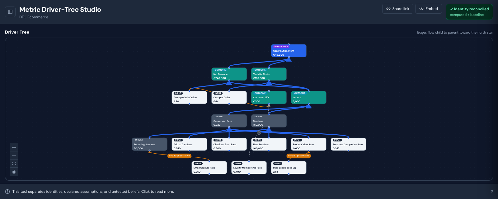
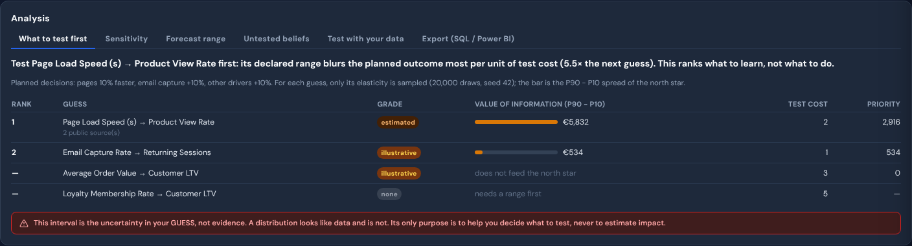
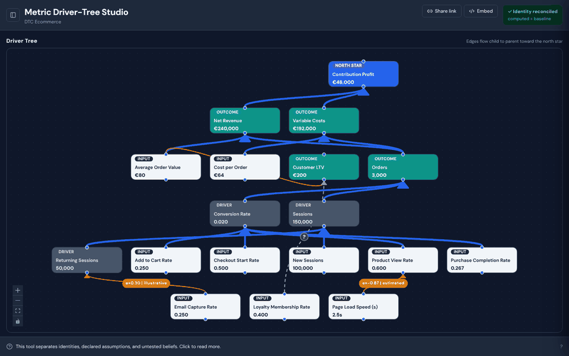
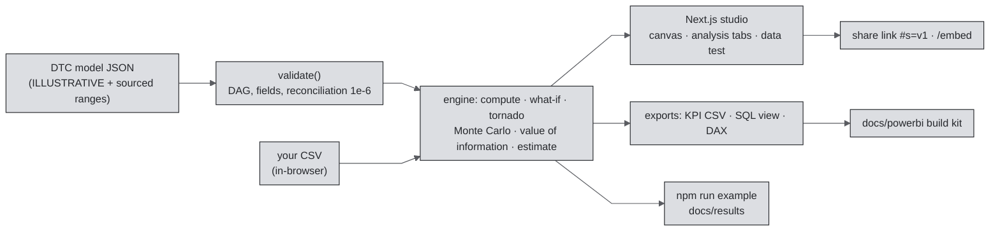

# Metric Driver-Tree Studio



[](https://github.com/RafaelBraga-Kribitz/metric_lineage_simulator/actions/workflows/governance.yml)
[](LICENSE)
[](#status)

**Status:** In development

A KPI tree (German: Kennzahlensystem) breaks one key metric into the drivers behind it. Most trees mix three kinds of claim in one formula. The first kind is a definition, true by construction. The second kind is an assumed elasticity: the percent change in one metric when another metric changes by 1 %. The third kind is a belief that nobody has tested. In one formula, a guess looks as solid as a definition. This studio keeps the three kinds apart. It forecasts what the guesses imply. It ranks which guess to test first.

- **Who decides:** a growth or experimentation lead at an online shop.
- **What they choose:** which untested guess to test first.
- **Answer:** test page speed first. Its uncertainty blurs contribution profit by €5,832 per period, 5.5× the value of the next guess per unit of test cost.
- **Main caveat:** the shop is illustrative, not a real one. The result ranks what to learn, not what to do.
- **Chart:** [the ranking panel](docs/assets/what-to-test-first.png), shown below.

## Decision summary

The studio draws a contribution-profit tree for a direct-to-consumer (DTC) online shop. Contribution profit is net revenue minus variable costs. It is the north star: the one metric at the top of the tree.

**Test the page-speed guess first.** The illustrative DTC model has a baseline of €48,000 contribution profit per period. A planned "10 % faster pages" decision has an uncertain outcome. One guess drives that uncertainty: how page load speed moves product-page views. This guess blurs the outcome by **€5,832 of contribution profit per period**. The blur is P90 − P10, the gap between the 90th and the 10th percentile of 20,000 simulated outcomes. The next guess, email capture, blurs the outcome by €534. Page speed gives 5.5× more value of information per unit of test cost. Value of information (VoI) measures how far a guess's uncertainty moves a planned outcome. The result ranks what to *learn*, not what to *do*.



*The ranking panel in the app. Bar length is the spread of the north star that each guess's declared range produces. Priority divides that spread by a declared test cost.*

The €5,832 figure comes from an elasticity range graded **estimated**. Its bound is translated from the public Deloitte for Google study [*Milliseconds Make Millions* (2020)](https://web.dev/case-studies/milliseconds-make-millions). That study associates 0.1 s faster mobile pages with +8.4 % retail conversion. The edge's note in the app explains the translation. The study is an external, observational benchmark. It is not a measurement of this shop.

To run the studio on your machine, use Node 20:

```bash
git clone https://github.com/RafaelBraga-Kribitz/metric_lineage_simulator.git
cd metric_lineage_simulator/driver_tree_studio
npm ci
npm run dev            # studio at http://localhost:3000
npm test               # 92 unit tests: engine, statistics, exports
npm run example        # regenerates the result above into docs/results/
```

The studio shows these skills in analyst terms:

- KPI and Kennzahlen design as a driver tree: Deckungsbeitrag (contribution profit) down to the conversion rate (Konversionsrate) of each funnel stage.
- Forecasting under uncertainty. Seeded Monte Carlo runs draw many random values from the declared ranges.
- A relationship test on your own CSV file.
- ETL-style validation (extract, transform, load): every identity must reconcile to 1e-6.
- A hand-off to the BI stack: SQL view definitions, a KPI dictionary CSV and Power BI DAX measures. DAX is the formula language of Power BI.
- A plain TypeScript engine with no statistics library, so every formula is readable in the source. The product contains no Python.

## See it running



*The walk-through shows the ranking, a tornado chart (bars sorted by how far each lever moves the north star), the forecast range, a data test and the export tab.*

No hosted demo exists. Deployment is an owner step. The static build and the Vercel config are ready ([docs/deploy.md](docs/deploy.md)). The command `npm run screenshots` captures every screen above from the built app.

## Start here

| Audience | Start here |
|---|---|
| Hiring manager, 2 minutes | [Decision summary](#decision-summary) → [Results](#results) → [Known limits](#known-limits) |
| Analyst / BI developer | [Power BI build kit](docs/powerbi/README.md) → [`kpi_tree.sql`](docs/powerbi/kpi_tree.sql) → [`measures.dax`](docs/powerbi/measures.dax) |
| Technical reviewer | [How it works](#how-it-works) → [`estimate.ts`](driver_tree_studio/src/engine/estimate.ts) → [Validation](#validation) → [scope decision record](governance/adrs/0010-portfolio-completion-scope.md) |

## Question

Take a contribution-profit tree for a direct-to-consumer shop. **Which uncertain assumption should the team test before it acts on the tree?** A second question runs through the whole tool. How do you show an assumption's uncertainty without dressing it up as evidence?

## Results

### Page speed ranks first: €5,832 value of information, 5.5× the next guess

| Rank | Guess | Grade | Planned change | Contribution profit P10 – P90 | VoI | Test cost | Priority |
|---|---|---|---|---|---|---|---|
| 1 | page load speed → product view rate | estimated | −10% load time | €49,534 – €55,366 | €5,832 | 2 | 2,916 |
| 2 | email capture → returning sessions | illustrative | +10% capture | €48,214 – €48,747 | €534 | 1 | 534 |
| — | average order value → customer LTV | illustrative | — | does not feed the north star | — | 3 | — |
| — | loyalty → customer LTV | none | — | needs a range first | — | 5 | — |

VoI is value of information (P90 − P10). Test cost is a declared relative effort unit. Priority is VoI divided by test cost.

On the €48,000 baseline, the page-speed range spans a profit gain of 3% to 15%. The email-capture range spans 0.4% to 1.6%. Page speed stays ahead after the division by a test cost that is twice as high. Run `npm run example` to reproduce the result. The full table and the sources are in [docs/results/worked_example.md](docs/results/worked_example.md). A test fails if the committed file drifts from a fresh run.

> This interval is the uncertainty in your GUESS, not evidence. A distribution looks like data and is not. Its only purpose is to help you decide what to test, never to estimate impact.

## Decision and next test

Run a speed test before you size any speed roadmap. Add or remove load time for a random share of sessions, or stage a rollout. Measure product-page views. Feed the result into the data-test tab. The edge's grade then moves from `estimated` to `experimental`. Its range narrows and the ranking updates.

## Data

| Input | What it is | Epistemic status |
|---|---|---|
| [`dtc_ecommerce.json`](driver_tree_studio/src/content/dtc_ecommerce.json) | 18 metrics, 14 identity edges, 3 modeled edges, 1 hypothesized edge; contribution profit €48,000 per period | Baselines **ILLUSTRATIVE** |
| Page speed → product views range | triangular(−2.1, −0.5, 0) elasticity; two public sources stored on the edge | **Estimated** from public benchmarks |
| Email capture → returning sessions range | triangular(0, 0.3, 0.6) | **ILLUSTRATIVE**; no public source found, flagged in the UI |
| Loyalty → LTV | direction only, with a selection-trap warning | **Hypothesized**; never computed |
| Your CSV (data-test tab) | any two numeric columns; read in the browser, never uploaded | yours |
| [`kpi_inputs_SYNTHETIC.csv`](docs/powerbi/kpi_inputs_SYNTHETIC.csv) | 12 months generated from the baselines with seeded 5% noise | **SYNTHETIC**, for the BI kit only |

ILLUSTRATIVE means a plausible value, not a measurement. SYNTHETIC means generated by code. A triangular range is set by its lowest, most likely and highest value. LTV is customer lifetime value.

German labels (Deckungsbeitrag, Warenkorbwert, Konversionsrate) are illustrative textbook terms. They are not any company's definitions. This repository holds no personal, scraped or client data.

## Validation

| Gate | What it checks | Result |
|---|---|---|
| `npm test` (vitest) | engine, identity reconciliation, functional forms, Monte Carlo, CSV, share-link limits, exports; the estimator against Anscombe's quartet set I (a small public dataset with known statistics); property-based tests (fast-check) | 92 tests pass |
| `npm run coverage` | engine + schema + lib | 94.6% lines; engine 97.6%; `estimate.ts` 99.2% |
| `npm run e2e` (Playwright) | real static build: three edge kinds, analysis tabs by keyboard, data test, share link → same numbers, embed, export download, **no console errors** | 7 tests pass |
| SQL export | the `kpi_tree` view recomputes every identity; executed in SQLite (and DuckDB during development) | matches the engine within 1e-6 |
| `npm run lint` / `typecheck` | strict TypeScript; ESLint bans raw hex colours in components and React imports in the engine | clean |

## Known limits

- **Illustrative baselines.** The DTC numbers are a plausible shape, not a real shop. Two of three modeled edges are still illustrative. So the project's own launch rule is not met. The rule says: do not attach the author's name to a public launch until a defended one-week authoring pass replaces the illustrative numbers.
- **Independence and multiplicativity.** Modeled effects multiply and are independent. Monte Carlo samples inputs independently, so order value and cost per order do not move together. This widens the ranges.
- **Association, not effect.** The data test on observational data reports association only. The verdict says so on every run. Only a randomized design that the user declares is labelled an effect estimate. The tool cannot check that the randomization was sound.
- **Value of information is a ranking device.** It measures how far a guess's declared range moves a planned outcome. A wider guess scores higher, whether or not it is right.
- **Benchmark transfer.** The page-speed bound comes from a multi-brand study that uses four speed metrics. It is not the median load time of one shop.
- **Single-player.** The studio has no accounts, no backend and no collaboration. State lives in the browser and in share links.
- **DAX is checked by structure, not in Power BI.** The kit lists the values a correct build must show.

## How it works

The studio draws three edge kinds. Each kind looks different everywhere in the UI.

| Kind | Canvas | What is claimed | Used in numbers |
|---|---|---|---|
| `identity` | thick blue | true by definition (`orders = sessions × conversion_rate`) | yes, exactly |
| `modeled` | amber + grade chip | an elasticity with a named functional form and a declared range | yes, flagged |
| `hypothesized` | grey dashed + “?” | a direction only | no |

1. **Compute.** Values flow from child to parent, each metric after its inputs. Modeled effects multiply onto their target.
2. **What-if and tornado.** Move any controllable input. A tornado chart lists the levers as bars, sorted by effect. It shows the north-star change at ±10% per lever.
3. **Forecast range.** A seeded Monte Carlo run in a Web Worker samples the input ranges and the elasticity ranges. It reports P10, P50 and P90: the 10th, 50th and 90th percentiles of the simulated north star. It also reports each input's share of the spread.
4. **Value of information.** For each modeled edge with a range, move its driver by the planned change. Sample only that edge's elasticity (20,000 draws). Take P90 − P10 of the north star. Priority is that spread divided by the declared test cost.
5. **Test with data.** The test reports Pearson r (the correlation) with a 95% confidence interval. The interval uses the Fisher-z transform, which makes the sampling distribution of r roughly normal. It also reports OLS (ordinary least squares, a straight-line fit) with a t-based slope interval, the elasticity at the means, and an 80/20 out-of-sample r². The verdict separates *association* from *effect*. Every verdict carries a fixed note and a “what would prove this” design. Accepting a result promotes the edge's grade to `observational`. It promotes the grade to `experimental` only if the user declares a randomized design.

## How it fits together

The studio is a static Next.js app over a framework-free TypeScript engine. The browser validates, computes and analyses a model. Node scripts produce the exports and the worked example with the same engine.



## Stack

| Layer | Choice |
|---|---|
| Engine | TypeScript 6 (strict), no runtime dependencies |
| App | Next.js 14 static export, React 18, React Flow 12, Recharts, Tailwind tokens from `CLAUDE_DESIGN_SYSTEM.md` |
| Tests | Vitest + fast-check, Playwright (Chromium), v8 coverage |
| Data hand-off | ANSI SQL (SQLite / DuckDB / PostgreSQL), Power BI DAX |
| Governance | Python 3.11 scripts, pytest, ruff / vulture / radon / knip / jscpd debt ratchet |

## Reproduce

```bash
git clone https://github.com/RafaelBraga-Kribitz/metric_lineage_simulator.git
cd metric_lineage_simulator/driver_tree_studio
npm ci
npm run dev            # studio at http://localhost:3000
npm run typecheck && npm run lint && npm test
npm run build && npx playwright install chromium && npm run e2e
npm run example        # headline result → docs/results/
npm run export         # SQL / CSV / DAX / theme → docs/powerbi/
npm run screenshots    # README images from the built UI (after npm run build)
cd .. && make verify   # governance + debt ratchet (pip install pyyaml pytest)
```

`npm test` runs 92 unit tests: engine, statistics and exports. Node 20 matches CI ([governance.yml](.github/workflows/governance.yml)). Contributors start each session with `make session-start` ([CLAUDE.md](CLAUDE.md)).

### Governance checks

`make verify` re-verifies every closed governance finding on every pull request. It also runs the debt ratchet, which fails if a measured debt metric grows past its baseline. Result: all closed findings hold.

## Repository structure

```text
driver_tree_studio/
  src/engine/        compute, graph, whatif, sensitivity, montecarlo, valueOfInformation, prioritize, estimate, workedExample
  src/lib/           formula parser, rng, stats, csv, exporters, powerbiKit, shareState
  src/components/    canvas, analysis tabs, data test, export, share
  src/workers/       Monte Carlo Web Worker
  src/content/       dtc_ecommerce.json, labels_de.json
  tests/, e2e/       vitest and Playwright suites
  scripts/           worked example, export kit, screenshots
docs/results/        headline worked example (generated)
docs/powerbi/        Power BI build kit (generated + guide)
governance/          decision records, closed findings, debt baseline
PROJECT_CHARTER.md   executive single source of truth
```

### Legend: codes in file names

Files in `governance/` carry short codes. Each code has a plain name here.

| Code in file names | Plain name |
|---|---|
| ADR-0004 | Product model and launch rule (decision record 0004) |
| ADR-0010 | Scope proposals for finishing the portfolio piece (decision record 0010) |
| ADR-0003 to ADR-0010 | Decision records in `governance/adrs/` |
| F-001 to F-022 | Governance findings, one file each in `governance/findings/` |

## Status

**Status:** In development

The product runs end to end on one model. It has the canvas, what-if, tornado chart, forecast range, data test, value-of-information ranking, share links, embed and exports. Last validated 2026-10-14 (92 unit tests, 7 end-to-end tests).

What does not exist yet: a hosted deployment, a `.pbix` file built from the kit, a non-illustrative range for the email-capture edge, and more models (SaaS, marketplace). The [scope decision record](governance/adrs/0010-portfolio-completion-scope.md) holds the scope decisions as proposals.

## License

ISC, as declared in `driver_tree_studio/package.json`. See [`LICENSE`](LICENSE).

## Author
<table>
  <tr>
    <td width="110">
      
    </td>
    <td>
      <strong>Rafael Braga-Kribitz</strong><br />
      Seiersberg-Pirka, Austria · Portfolio project, 2026<br />
      <a href="https://www.linkedin.com/in/rafaelbragakribitz/">LinkedIn</a>
      ·
      <a href="mailto:rafaelbragakribitz@gmail.com">rafaelbragakribitz@gmail.com</a>
    </td>
  </tr>
</table>
